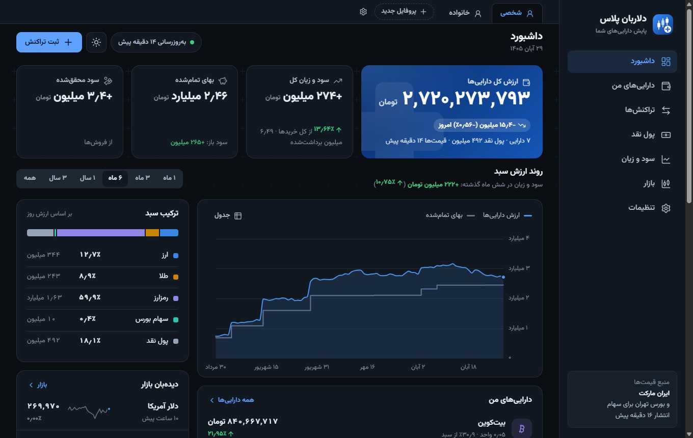
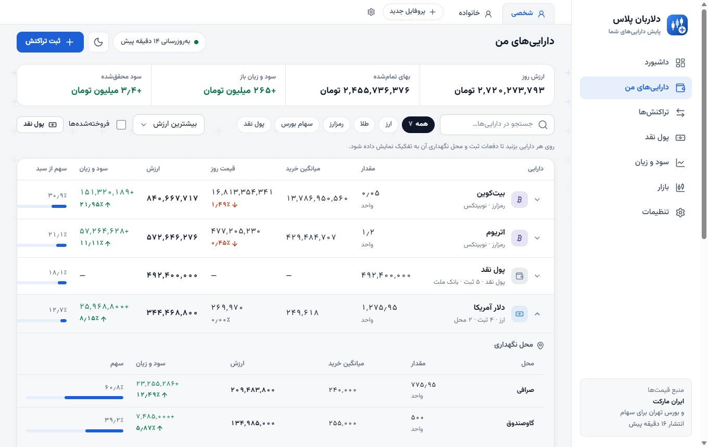
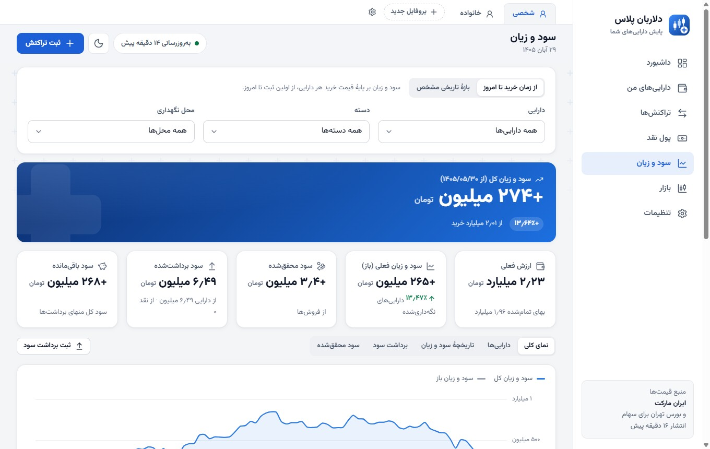
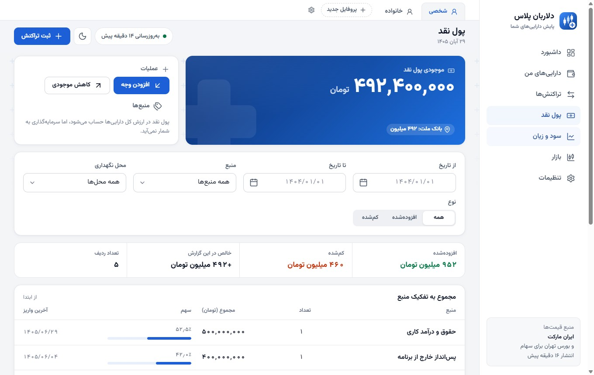
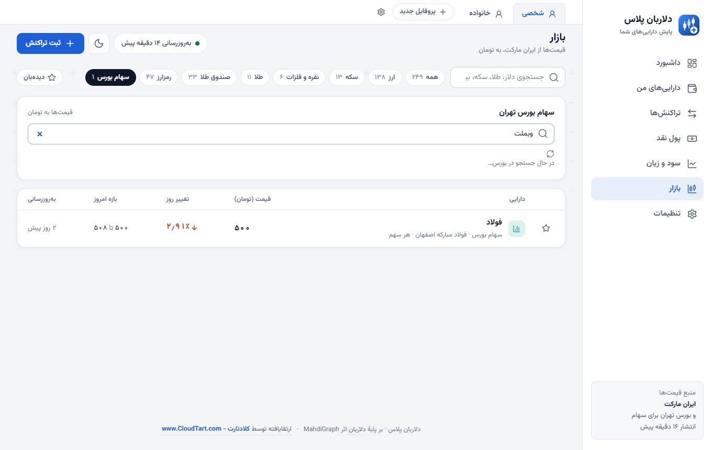
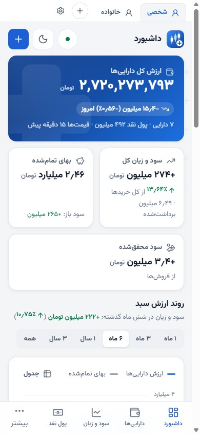
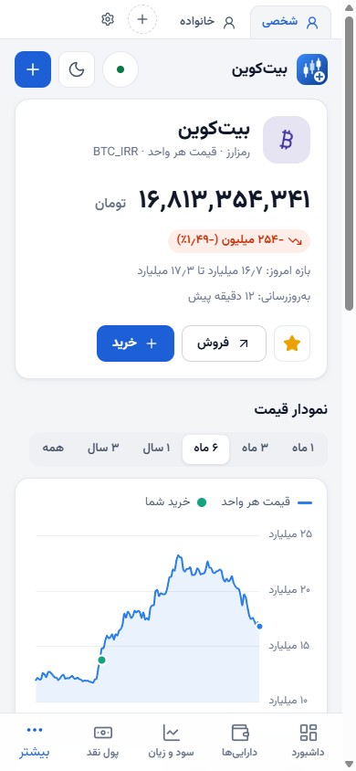
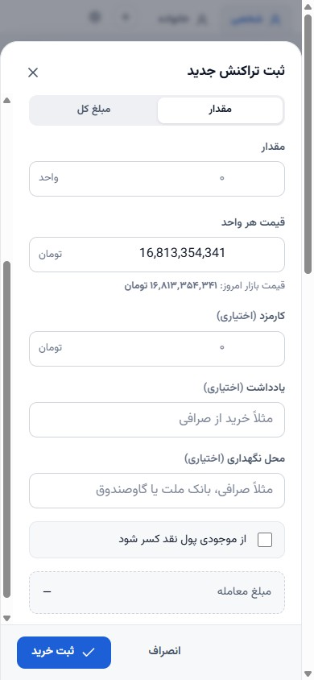

# دلاربان پلاس | DollarBaan Plus

<p align="center">
  <a href="https://github.com/farshad-zamani/DollarBaan-Plus/releases/latest"></a>
  
  
  
  <a href="https://github.com/MahdiGraph/DollarBaan"></a>
</p>

<p align="center">
  
</p>

<p align="center">
  <a href="https://github.com/farshad-zamani/DollarBaan-Plus/releases/latest"><b>دانلود برنامه</b></a> ·
  <a href="#-امکانات-دلاربان-پلاس">امکانات</a> ·
  <a href="#-مهاجرت-از-دلاربان">مهاجرت از دلاربان</a> ·
  <a href="#-نصب-روی-سرور">نصب روی سرور</a> ·
  <a href="CHANGELOG.md">تغییرات نسخه‌ها</a> ·
  <a href="#english-summary">English</a>
</p>

> **دلاربان پلاس نسخهٔ توسعه‌یافتهٔ [دلاربان (DollarBaan)](https://github.com/MahdiGraph/DollarBaan) است**؛ پروژه‌ای متن‌باز و زیبا از [MahdiGraph](https://github.com/MahdiGraph) که ثبت دارایی، میانگین قیمت خرید، سود و زیان و برنامه‌های دسکتاپ و اندروید را از پایه ساخته است. پلاس بر همان پایه ساخته شده، با مجوز MIT منتشر می‌شود و **پروژهٔ رسمی دلاربان نیست**. اگر فقط به یک سبد ساده نیاز دارید، پروژهٔ اصلی را هم ببینید.

## 📋 معرفی

**دلاربان پلاس** یک داشبورد مالی شخصی و متن‌باز برای ایرانیان است: خرید و فروش ارز، طلا، سکه، رمزارز، **سهام بورس تهران** و **پول نقد** را ثبت می‌کنید و ارزش لحظه‌ای سبد، میانگین قیمت خرید، سود و زیان و روند دارایی‌هایتان را **به تومان** می‌بینید. داده‌ها فقط روی دستگاه خودتان می‌ماند و هیچ حساب کاربری یا سروری لازم نیست.

نسخه‌های ویندوز، مک، لینوکس و اندروید به سرور نیاز ندارند؛ برای دسترسی از چند دستگاه می‌توانید نسخهٔ سرور را روی سرور شخصی خودتان اجرا کنید. دلاربان پلاس را می‌توان **کنار دلاربان اصلی نصب کرد**؛ شناسه و پوشهٔ داده‌هایشان جداست.

## 📥 دانلود

آخرین نسخه را از **[Releases](https://github.com/farshad-zamani/DollarBaan-Plus/releases/latest)** بگیرید:

| سیستم‌عامل | فایل |
|---|---|
| ویندوز ۱۰ و ۱۱ | `DollarBaanPlus-…-windows-setup.exe` (نصبی) یا `…-windows-portable.exe` (بدون نصب) |
| مک با تراشه اپل (M1 و جدیدتر) | `DollarBaanPlus-…-mac-arm64.dmg` |
| مک اینتل | `DollarBaanPlus-…-mac-x64.dmg` |
| لینوکس | `…-linux-amd64.deb` برای اوبونتو و دبیان، `…-linux-x86_64.AppImage` برای سایر توزیع‌ها |
| اندروید ۷ و جدیدتر | `DollarBaanPlus-…-android.apk` |

- برنامه‌ها امضای تجاری ندارند؛ اگر بار اول هشدار دیدید، راهنمای [اولین اجرا](#-رفع-اشکال) را ببینید.
- برنامه‌ها جز دریافت قیمت‌های عمومی بازار به هیچ جایی وصل نمی‌شوند و هیچ اطلاعاتی از شما نمی‌فرستند.

## ✨ امکانات دلاربان پلاس

افزون بر همهٔ امکانات دلاربان (دارایی دستی، میانگین قیمت خرید، سود محقق‌شده، تقویم شمسی، حالت تیره و…):

- **چند پروفایل:** هر پروفایل یک محیط کاملاً جداگانه است (دارایی‌ها، تراکنش‌ها، پول نقد، تنظیمات و دیده‌بان) و مثل تب بالای برنامه باز می‌شود. هر تعداد پروفایل بسازید و هر نامی بگذارید؛ ترتیب تب‌ها قابل تغییر است.
- **همهٔ بورس تهران در بازار:** سهام، حق تقدم، صندوق‌های سرمایه‌گذاری و صندوق‌های طلا و کالا مثل ارز و طلا به‌صورت پیش‌فرض در بخش «بازار» و در جستجوی دارایی هنگام ثبت تراکنش هستند؛ نیازی به تعریف جداگانه نیست. قیمت به تومان است، تاریخچه هنگام نیاز دریافت می‌شود و خرید و فروش مثل هر دارایی دیگری ثبت و محاسبه می‌شود.
- **قیمت همان تاریخ:** در فرم تراکنش، دکمهٔ «دریافت قیمت این تاریخ» قیمت بازار روز انتخاب‌شده را برای هر دارایی دوباره می‌گیرد و در فیلد قیمت می‌گذارد.
- **پول نقد (دارایی ریالی):** موجودی نقد در ارزش کل حساب می‌شود، بدون آن‌که به‌عنوان سرمایه‌گذاری شمرده شود.
  - هنگام افزودن وجه، **منبع آن** را انتخاب می‌کنید: سود محقق‌شده در برنامه، سود خارج از برنامه، پس‌انداز خارج از برنامه، حقوق، هدیه، وام و… . منبع‌های دلخواه خودتان را هم بسازید.
  - برای هر منبع **مجموع و تاریخچه** دارید و گزارش را با فیلتر تاریخ، منبع و محل می‌بینید و به اکسل می‌دهید.
  - هنگام ثبت **خرید**، می‌پرسد آیا مبلغ از موجودی نقد کم شود؛ هنگام **فروش**، می‌پرسد آیا به نقد اضافه شود. ردیف نقد همراه تراکنش خودکار به‌روز می‌شود.
- **محل نگهداری:** برای هر تراکنش و هر ردیف پول نقد اختیاری است (صرافی، بانک، گاوصندوق، کیف پول…). در «دارایی‌های من» هر دارایی یک **آکاردئون** دارد که تک‌تک دفعات ثبت (به تفکیک روز) و محل هر کدام و موجودی هر محل را نشان می‌دهد.
- **سود و زیان:** منو و داشبورد مخصوص با فیلتر روی دارایی، دسته و محل نگهداری و دو حالت:
  - **از زمان خرید تا امروز**، بر پایهٔ قیمت خرید؛
  - **از یک تاریخ یا بازهٔ تاریخی**: دارایی‌ها از آن تاریخ چقدر رشد یا کاهش داشته‌اند (خرید و فروش داخل بازه جابه‌جایی پول حساب می‌شود، نه سود).

  سود و زیان فعلی، سود محقق‌شده و سود برداشت‌شده هر کدام کارت، تاریخچه و جدول جدا دارند.
- **برداشت سود:** مبلغی را که از سودتان برداشته‌اید ثبت کنید؛ از یک یا چند دارایی (ترکیبی یا با تقسیم خودکار متناسب با سود) یا از موجودی نقد. پول به موجودی نقد اضافه می‌شود یا از برنامه خارج می‌شود. فقط از **سود** می‌توان برداشت؛ مقدار دارایی به قیمت همان روز کم می‌شود و سرمایهٔ اصلی در سبد می‌ماند.
- **قفل برنامه** (دسکتاپ و اندروید): رمز با **یادآور رمز**، قفل خودکار و هشدار دربارهٔ فراموشی رمز. رمز فقط روی دستگاه شما نگه‌داری می‌شود؛ چون هیچ اطلاعاتی از کاربران دریافت نمی‌شود، **بازیابی رمز ممکن نیست** و در صورت فراموشی باید برنامه حذف و دوباره نصب شود (از فایل پشتیبان می‌توانید بازیابی کنید).
- **پشتیبان‌گیری کامل:** پشتیبان هر پروفایل یا یک فایل از **همهٔ پروفایل‌ها و تنظیمات**، با بازیابی ساده. پشتیبان دلاربان اصلی را هم می‌توانید در هر پروفایلی بازیابی کنید.
- **تم آبی** و رابط راست‌به‌چپ با فونت وزیرمتن، تقویم شمسی و حالت روشن و تیره.

<p align="center">
  
  
</p>

<p align="center">
  
  
</p>

<p align="center">
  
  
  
</p>

## 🔌 منبع داده‌ها

| دارایی | منبع | هزینه |
|---|---|---|
| ارز، طلا، سکه، فلزات و رمزارز | [ایران مارکت (Iran Market Data)](https://github.com/iran-market/iran-market.github.io)، هر ۳۰ دقیقه | رایگان، بدون کلید |
| سهام، صندوق‌ها و صندوق‌های طلا و کالا (همهٔ بورس تهران) | سامانهٔ عمومی بورس تهران (TSETMC)، هر ۳۰ دقیقه | رایگان، بدون کلید |
| ارز، طلا و سکه (اختیاری، نسخهٔ سرور) | [نوسان](https://navasan.tech) | پلن رایگان ۱۲۰ درخواست در ماه، با کلید API |

- قیمت‌های دلاری (مثل انس طلا) با نرخ تتر یا دلار آزاد به تومان تبدیل می‌شوند.
- قیمت سهام به تومان نشان داده می‌شود (بورس ریال اعلام می‌کند). قیمت لحظه‌ای «آخرین معامله» است و در روزهای تعطیل بازار، آخرین قیمت روز کاری قبل.
- از **تنظیمات › منبع قیمت‌ها** می‌توانید منبع، آدرس دریافت داده و بازهٔ به‌روزرسانی را تغییر دهید و اتصال را آزمایش کنید.

## 🔁 مهاجرت از دلاربان

دلاربان پلاس کنار دلاربان اصلی نصب می‌شود و داده‌هایشان جداست. برای انتقال:

1. در دلاربان اصلی از **تنظیمات › پشتیبان‌گیری** فایل پشتیبان را دانلود کنید.
2. در دلاربان پلاس به **تنظیمات › پشتیبان‌گیری و بازیابی** بروید، پروفایل مقصد را انتخاب کنید (یا «پروفایل جدید…») و فایل را انتخاب کنید.

تراکنش‌ها، دارایی‌های دستی و تنظیمات دقیقاً همان‌طور منتقل می‌شوند. اگر بخواهید همهٔ اطلاعات پروفایل با فایل یکی باشد، گزینهٔ «جایگزینی کامل» را بزنید.

## 💻 نصب روی سرور

اگر فقط روی یک دستگاه از دلاربان پلاس استفاده می‌کنید، [برنامهٔ آماده](#-دانلود) ساده‌ترین راه است. نسخهٔ سرور برای دسترسی از چند دستگاه (کامپیوتر، گوشی، مرورگر) به یک سبد مشترک با رمز عبور است. در نسخهٔ سرور هم پروفایل‌ها پشتیبانی می‌شوند و هر پروفایل پایگاه‌دادهٔ جدا دارد.

### روش ۱: Node.js

پیش‌نیاز: **Node.js نسخهٔ ۲۰.۱۹ یا بالاتر** (پیشنهاد: ۲۲ LTS).

```bash
git clone https://github.com/farshad-zamani/DollarBaan-Plus.git
cd DollarBaan-Plus
npm install
cp .env.template .env   # رمز عبور را در این فایل عوض کنید
npm start
```

حالا برنامه روی `http://localhost:3000` در دسترس است. نام کاربری و رمز پیش‌فرض `admin` و `changeit` است؛ حتماً آن را در `.env` یا از **تنظیمات › امنیت** تغییر دهید.

### روش ۲: Docker

```bash
git clone https://github.com/farshad-zamani/DollarBaan-Plus.git
cd DollarBaan-Plus
cp .env.template .env   # اختیاری؛ برای تغییر نام کاربری و رمز
docker compose up -d --build
```

داده‌ها در volume با نام `dollarbaan-plus-data` نگه‌داری می‌شوند و با به‌روزرسانی کانتینر از بین نمی‌روند.

### اجرای دائمی با PM2

```bash
npm install -g pm2
pm2 start ecosystem.config.js
pm2 save && pm2 startup
```

دستورهای مفید: `pm2 status`، `pm2 logs DollarBaanPlus` و `pm2 restart DollarBaanPlus`.

## ⚙️ تنظیمات `.env`

| متغیر | پیش‌فرض | توضیح |
|---|---|---|
| `AUTH_USERNAME` / `AUTH_PASSWORD` | `admin` / `changeit` | اطلاعات ورود. بعد از تغییر رمز از تنظیمات، رمز ذخیره‌شده در دیتابیس ملاک است. |
| `PORT` | `3000` | پورت برنامه |
| `TRUST_PROXY` | `false` | اگر پشت nginx، Caddy یا Cloudflare هستید `true` کنید. |
| `COOKIE_SECURE` | `auto` | کوکی امن فقط روی HTTPS؛ `true` یا `false` برای اجبار |
| `SESSION_MAX_AGE` | ۷ روز | مدت اعتبار نشست ورود (میلی‌ثانیه) |
| `DB_DIALECT` | `sqlite` | `sqlite` یا `mysql` |
| `SQLITE_PATH` | `./database.sqlite` | مسیر فایل دیتابیس SQLite؛ پروفایل‌های دیگر کنار آن با پسوند شناسه ساخته می‌شوند. |
| `DB_NAME`، `DB_USER`، `DB_PASSWORD`، `DB_HOST`، `DB_PORT` | | تنظیمات MySQL/MariaDB؛ هر پروفایل یک دیتابیس `<DB_NAME>_<شناسه>` می‌سازد (کاربر باید اجازهٔ ساخت دیتابیس داشته باشد). |
| `PRICE_PROVIDER` | `iran-market` | منبع اولیهٔ قیمت (`iran-market` یا `navasan`) |
| `IRAN_MARKET_MIRROR` | `github` | `github`، `jsdelivr` یا `custom` |
| `IRAN_MARKET_BASE_URL` | | آدرس آینهٔ اختصاصی پوشهٔ `data` |
| `NAVASAN_API_KEY` | | کلید نوسان (فقط برای منبع نوسان) |
| `REFRESH_INTERVAL_MINUTES` | `30` | بازهٔ اولیهٔ به‌روزرسانی قیمت‌ها |
| `LOG_LEVEL` / `LOG_DIR` | `info` / `./logs` | سطح و پوشهٔ لاگ؛ `LOG_DIR=off` یعنی فقط خروجی کنسول |

منبع قیمت، بازهٔ به‌روزرسانی، واحد نمایش (تومان یا ریال)، بازهٔ نمودار و دیده‌بان از داخل برنامه تنظیم می‌شوند و مقادیر بالا فقط مقدار اولیه‌اند.

## 🖥️ راهنمای استفاده

1. با دکمهٔ **ثبت تراکنش** خرید یا فروش ثبت کنید: دارایی (یا سهم) را جستجو کنید، تاریخ شمسی را انتخاب کنید و مقدار یا مبلغ کل را بنویسید. قیمت بازارِ آن روز خودکار پر می‌شود و قابل ویرایش است. **محل نگهداری** را اگر خواستید بنویسید.
2. از **پول نقد** موجودی نقد را اضافه کنید و منبع آن را بگویید؛ بعد از آن، هنگام ثبت خرید و فروش پیشنهاد کسر یا افزودن به نقد را می‌بینید.
3. در **دارایی‌های من** روی هر دارایی بزنید تا دفعات ثبت و محل نگهداری آن را ببینید.
4. در **سود و زیان** حالت و فیلترها را انتخاب کنید؛ از همان‌جا **برداشت سود** هم ثبت می‌شود.
5. از تب‌های بالای برنامه پروفایل بسازید و بین آن‌ها جابه‌جا شوید.
6. از **تنظیمات › پشتیبان‌گیری** هر چند وقت یک بار پشتیبان بگیرید.

## 🔒 نکات امنیتی

### حریم خصوصی: چه چیزی از دستگاه خارج می‌شود؟

دسکتاپ و اندروید هیچ حساب، سرور، آمارگیر، تبلیغ یا گزارش خطایی ندارند و پروژه هیچ داده‌ای از کاربران دریافت نمی‌کند. دارایی‌ها، تراکنش‌ها، مبلغ‌ها، پول نقد، محل نگهداری، یادداشت‌ها و رمز قفل فقط روی همان دستگاه می‌مانند (پایگاه‌دادهٔ داخلی برنامه) و پشتیبان خودکار اندروید (Google Backup) هم برای آن‌ها غیرفعال است. برنامه فقط این درخواست‌های **GET عمومی و بدون بدنه** را می‌فرستد؛ هیچ‌کدام مبلغ، تعداد یا نام پروفایل شما را ندارد:

| به کجا | برای چه | چه چیزی در درخواست دیده می‌شود |
|---|---|---|
| `raw.githubusercontent.com` یا `cdn.jsdelivr.net` (ایران مارکت) | قیمت ارز، طلا، سکه و رمزارز | فقط نشانی عمومی فایل داده؛ همهٔ بازار دریافت می‌شود، نه دارایی‌های شما |
| `cdn.tsetmc.com` (بورس تهران) | فهرست و قیمت همهٔ سهام و صندوق‌ها (یک درخواست)، تاریخچهٔ هر نماد، جستجوی نمادهای دیگر | برای فهرست کامل چیزی خاص نیست؛ برای تاریخچه، کد نمادی که دارید یا می‌بینید؛ برای جستجو، عبارت جستجو |
| `api.wallex.ir`، `api.binance.com`، `api.frankfurter.dev` | تاریخچهٔ قیمت قدیمی رمزارز و ارز، فقط وقتی خریدی در گذشته ثبت کنید | نماد دارایی و بازهٔ تاریخ (تقریباً تاریخ نخستین خرید) |
| `api.github.com` | خبر دادن نسخهٔ تازه (دسکتاپ و اندروید، حداکثر هر ۱۲ ساعت) | هیچ چیز جز آدرس IP و نسخهٔ مرورگر داخلی |

هر سرویس‌دهنده طبق روال همهٔ سایت‌ها آدرس IP شما را می‌بیند. اگر نمی‌خواهید، دستگاه را پشت VPN بگذارید یا برنامه را بدون اینترنت به‌کار ببرید (قیمت‌ها به‌روز نمی‌شوند). به‌جز سهام و تاریخچهٔ قدیمی، فهرست دارایی‌های شما از هیچ درخواستی قابل حدس نیست؛ در آن دو مورد، سرویس مربوط می‌تواند ببیند کدام نماد را دنبال می‌کنید (نه مبلغ و نه هویت شما).

### آدرس‌هایی که برنامه به آن‌ها وصل می‌شود

اگر برنامه را پشت تونل، پراکسی یا فایروال اجرا می‌کنید، این دامنه‌ها (فقط HTTPS) باید در دسترس باشند. دو دامنهٔ اول سرویس‌های ایرانی‌اند و از خارج از ایران ممکن است بسته باشند؛ بقیه جهانی‌اند.

| دامنه | برای چه | لازم است؟ |
|---|---|---|
| `cdn.tsetmc.com` | سهام، صندوق‌ها و صندوق‌های طلا (بورس تهران) | برای سهام و صندوق‌ها (ایرانی) |
| `api.wallex.ir` | تاریخچهٔ قدیمی رمزارز به تومان | اختیاری (ایرانی) |
| `raw.githubusercontent.com` | قیمت ارز، طلا، سکه و رمزارز (ایران مارکت) | بله |
| `cdn.jsdelivr.net` | آینهٔ جایگزین همان قیمت‌ها | پیشنهادی |
| `api.binance.com` | تاریخچهٔ قدیمی رمزارز اگر Wallex در دسترس نباشد | اختیاری |
| `api.frankfurter.dev` | نرخ بانک مرکزی اروپا برای تاریخچهٔ قدیمی ارزها | اختیاری |
| `api.github.com` | خبر نسخهٔ تازه (دسکتاپ و اندروید) | اختیاری |
| `api.navasan.tech` | فقط اگر در نسخهٔ سرور منبع «نوسان» را انتخاب کنید | اختیاری |

سایت بورس اگر در مدت کوتاه درخواست زیاد دریافت کند، آدرس IP را موقتاً مسدود می‌کند (خطای HTTP 403). برنامه برای همین همهٔ بازار را با **یک درخواست** هر ۳۰ دقیقه می‌گیرد؛ اگر 403 دیدید، چند دقیقه صبر کنید.

### توصیه‌ها

- رمز پیش‌فرض نسخهٔ سرور را حتماً عوض کنید. برای دسترسی از اینترنت، برنامه را پشت HTTPS قرار دهید و `TRUST_PROXY=true` کنید. نمونه تنظیم nginx:

```nginx
server {
    server_name dollar.example.com;
    location / {
        proxy_pass http://127.0.0.1:3000;
        proxy_set_header Host $host;
        proxy_set_header X-Forwarded-For $proxy_add_x_forwarded_for;
        proxy_set_header X-Forwarded-Proto $scheme;
    }
}
```

- قفل برنامهٔ دسکتاپ و اندروید مانع باز شدن برنامه می‌شود؛ فایل‌های داده را رمزگذاری نمی‌کند. برای محافظت کامل از رمزگذاری دیسک دستگاه استفاده کنید.
- فایل پشتیبان کامل اگر کلید API نوسان را وارد کرده باشید شامل آن است؛ فایل را امن نگه دارید.

## 🛠️ توسعه

```bash
npm run dev   # اجرای سرور با راه‌اندازی مجدد خودکار
npm test      # اجرای تست‌ها
```

ساختار پروژه:

```
public/                  رابط کاربری (JavaScript ماژولار بدون فریم‌ورک و بدون build)
  assets/js/shared/      منطق مشترک سرور و برنامه‌ها: دفتر تراکنش، منابع قیمت، همگام‌سازی و API
  assets/js/shared/plus/ ویژگی‌های دلاربان پلاس: پول نقد، برداشت سود، سود و زیان، سهام، پشتیبان
  assets/js/plus/        رابط پروفایل‌ها، قفل برنامه و فرم‌های پلاس
  assets/js/local/       بک‌اند داخلی برنامه‌ها روی IndexedDB (هر پروفایل یک پایگاه‌داده)
server/                  سرور (Express 5 و Sequelize) روی همان منطق مشترک
desktop/                 برنامهٔ دسکتاپ (Electron)
mobile/                  برنامهٔ اندروید (Capacitor)
scripts/                 ساخت آیکون‌ها، همگام‌سازی نسخه، تست اجرای برنامه‌ها، کلید امضای اندروید
test/                    تست‌ها (node:test)
```

رابط کاربری دو حالت دارد: در نسخهٔ سرور درخواست‌ها به API سرور می‌رود و در برنامه‌ها همان API داخل خود برنامه اجرا می‌شود.

### ساخت برنامه‌ها

```bash
# دسکتاپ: اجرا در حالت توسعه، و ساخت فایل نصب برای سیستم‌عامل فعلی در desktop/dist
cd desktop && npm install
npm start
npm run dist

# اندروید: نیاز به JDK 21 و Android SDK
cd mobile && npm install
npx cap sync android
npx cap open android   # باز کردن در Android Studio؛ یا: npm run apk
```

### انتشار نسخهٔ جدید

با هر تگ نسخه، GitHub Actions همهٔ برنامه‌ها را می‌سازد، روی ویندوز، مک، لینوکس و شبیه‌ساز اندروید اجرا و آزمایش می‌کند و در Releases منتشر می‌کند:

```bash
# نسخه را در package.json تغییر دهید و تغییرات را در CHANGELOG.md بنویسید، سپس:
npm run version:sync
git commit -am "Release 1.2.1" && git tag v1.2.1 && git push && git push --tags
```

فایل APK فقط وقتی منتشر می‌شود که کلید امضای اندروید یک بار ساخته شده باشد: `bash scripts/android-signing.sh` (کلید بیرون از مخزن ساخته و در Secrets مخزن ذخیره می‌شود؛ از پوشهٔ آن نسخهٔ پشتیبان نگه دارید، چون به‌روزرسانی APK فقط با همین کلید ممکن است).

آیکون‌ها از `public/assets/img/logo.svg` ساخته می‌شوند: `npm install --no-save sharp && node scripts/build-app-icons.js`

تغییرات پروژهٔ اصلی را با راهنمای [UPSTREAM.md](UPSTREAM.md) می‌توان به این مخزن آورد.

## 🔧 رفع اشکال

- **ویندوز پیام «Windows protected your PC» نشان می‌دهد:** روی «More info» و سپس «Run anyway» بزنید. این پیام به‌خاطر نداشتن گواهی امضای تجاری است.
- **مک برنامه را باز نمی‌کند:** به System Settings › Privacy & Security بروید و «Open Anyway» را بزنید، یا در ترمینال اجرا کنید: `xattr -dr com.apple.quarantine /Applications/DollarBaanPlus.app`
- **AppImage روی اوبونتو ۲۴.۰۴ اجرا نمی‌شود:** فایل deb را نصب کنید (پروفایل AppArmor لازم را خودش نصب می‌کند)، یا AppImage را با `--no-sandbox` اجرا کنید.
- **اندروید اجازهٔ نصب نمی‌دهد:** در تنظیمات گوشی اجازهٔ «نصب برنامه‌های ناشناس» را به مرورگر یا مدیر فایل بدهید. نسخه‌های بعدی روی همین نصب به‌روز می‌شوند و داده‌ها حفظ می‌شود.
- **قیمت‌ها دریافت نمی‌شوند:** در تنظیمات دکمهٔ «آزمایش اتصال» را بزنید. اگر GitHub روی سرورتان در دسترس نیست، آدرس دریافت داده را jsDelivr یا یک آینهٔ شخصی بگذارید.
- **قیمت سهام دریافت نمی‌شود:** سامانهٔ بورس تهران ممکن است از خارج از ایران یا پشت برخی فیلترشکن‌ها در دسترس نباشد؛ در تنظیمات وضعیت آخرین دریافت سهام نوشته شده است.
- **رمز برنامه را فراموش کرده‌ام:** بازیابی ممکن نیست؛ برنامه را حذف و دوباره نصب کنید و از فایل پشتیبان بازیابی کنید.
- **خطای sqlite3 یا `require` هنگام اجرای سرور:** نسخهٔ Node.js را بررسی کنید (۲۰.۱۹ یا بالاتر) و `npm install` را دوباره اجرا کنید.
- **جزئیات بیشتر:** `LOG_LEVEL=debug` را تنظیم کنید و فایل‌های پوشهٔ `logs` یا خروجی `pm2 logs` را ببینید.

## 📄 مجوز و اعتبار

دلاربان پلاس با مجوز MIT منتشر شده است؛ جزئیات در [LICENCE.md](LICENCE.md) (اعلان حق نشر پروژهٔ اصلی در آن حفظ شده است). مجوز اجزای ثالث در [THIRD_PARTY_NOTICES.md](THIRD_PARTY_NOTICES.md) آمده است.

- **پروژهٔ اصلی:** [دلاربان](https://github.com/MahdiGraph/DollarBaan) اثر Mahdi Talebi ([MahdiGraph](https://github.com/MahdiGraph)).
- **ارتقا و توسعهٔ دلاربان پلاس:** [کلادتارت - www.CloudTart.com](https://cloudtart.com)

قیمت‌ها صرفاً برای اطلاع‌رسانی هستند و توصیهٔ خرید یا فروش محسوب نمی‌شوند.

## 🤝 مشارکت

پیشنهادها و گزارش‌های خطا را در [Issues](https://github.com/farshad-zamani/DollarBaan-Plus/issues) ثبت کنید. Pull Requestها هم با کمال میل پذیرفته می‌شوند. اگر مشکلی مربوط به بخش‌های مشترک با دلاربان است، می‌توانید آن را در [مخزن اصلی](https://github.com/MahdiGraph/DollarBaan/issues) هم گزارش دهید.

---

## English summary

**DollarBaan Plus (دلاربان پلاس)** is an enhanced, unofficial fork of [DollarBaan](https://github.com/MahdiGraph/DollarBaan) by MahdiGraph (MIT), a self-hosted and offline personal finance dashboard for Iranian assets in Toman. It adds:

- **Multiple profiles** as tabs, each a fully separate workspace (a separate database per profile, also on the server).
- **Tehran Stock Exchange** stocks and funds: search, add, track prices and history in Toman.
- **Cash** as an asset with user-defined deposit sources, per-source reports and history; optional deduction from cash on a buy and addition on a sell.
- **Storage locations** per transaction and an expandable lots view per holding.
- A **profit and loss** dashboard (since purchase, or from a date/period) filterable by asset, category and location, plus **profit withdrawals** (profit only, to cash or out of the app).
- An **app lock** (desktop and Android) with a password hint, and **full backups** of all profiles and settings; backups made by the original DollarBaan restore into any profile.
- A blue theme and a separate app identity, so both apps can be installed side by side.

Apps for Windows, macOS, Linux and Android need no server or account; data stays on the device. Or self-host it with Node.js 20.19+, PM2 or Docker Compose:

```bash
git clone https://github.com/farshad-zamani/DollarBaan-Plus.git && cd DollarBaan-Plus
npm install && cp .env.template .env && npm start   # http://localhost:3000
```

---

<p align="center">
  <strong>دلاربان پلاس</strong> | پایش دارایی‌های شما، ساده و شخصی<br>
  ارتقا‌یافته توسط <a href="https://cloudtart.com"><strong>کلادتارت - www.CloudTart.com</strong></a>
</p>
